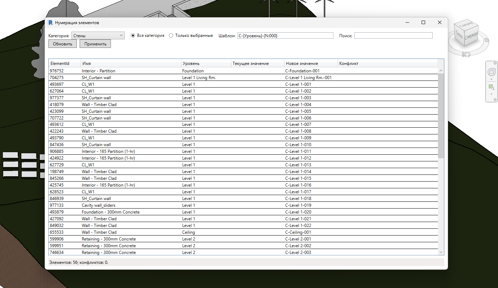
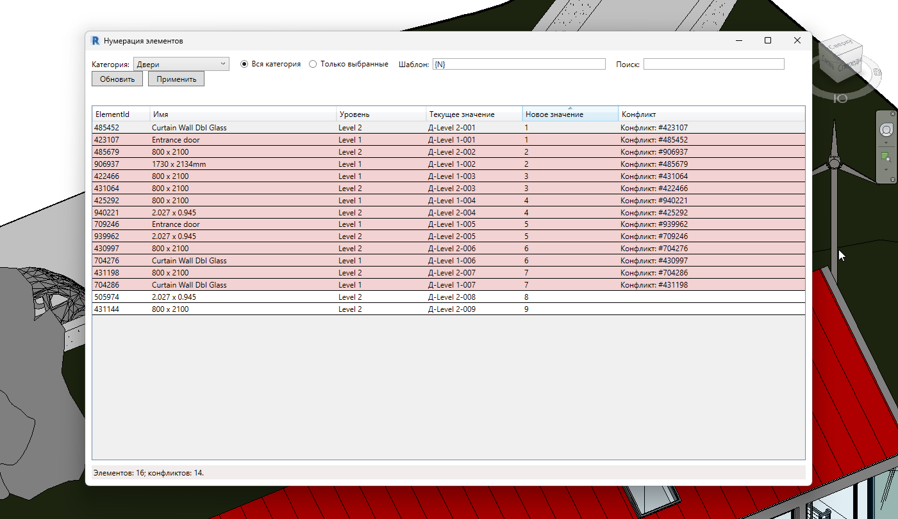

# RevitNumbering

Плагин Revit для просмотра и нумерации элементов выбранной категории с записью номеров в параметры модели.

Категории: стены, двери, окна, помещения. У стен, дверей и окон нумеруется `Mark`(Марка), у помещений - `Номер` (`ROOM_NUMBER`).

<p align="center">
  
</p>

## Сборка

Версия Revit задаётся свойством `RevitVersion` (по умолчанию `2024`):

```powershell
dotnet build RevitNumbering.sln -c Release -p:RevitVersion=2022
dotnet build RevitNumbering.sln -c Release -p:RevitVersion=2024
```

Результат:

```
artifacts/2022/Release/RevitNumbering.Revit.dll
artifacts/2024/Release/RevitNumbering.Revit.dll
```

Тесты:

```powershell
dotnet test RevitNumbering.Tests\RevitNumbering.Tests.csproj
```

## Установка

Закройте Revit и выполните:

```powershell
.\scripts\install.ps1 -Configuration Release
```

Скрипт соберёт и скопирует плагин в:

```
%AppData%\Autodesk\Revit\Addins\2022\RevitNumbering\
%AppData%\Autodesk\Revit\Addins\2024\RevitNumbering\
```

и положит рядом `RevitNumbering.addin`.

Можно установить вручную: скопировать содержимое `artifacts/<версия>/Release` в `%AppData%\Autodesk\Revit\Addins\<версия>\RevitNumbering\`, а `addin\RevitNumbering.addin` - в `%AppData%\Autodesk\Revit\Addins\<версия>\`.

При первом запуске Revit подтвердите загрузку плагина («Always Load»).

## Запуск

Вкладка **«Нумерация»** → панель **«Инструменты»** → **«Нумерация элементов»**.

1. Выберите категорию.
2. Выберите охват: «Вся категория» или «Только выбранные».
3. Задайте шаблон.
4. Проверьте таблицу и конфликты.
5. Нажмите «Применить».

## Шаблон номера

Подстановки:

| Подстановка | Значение |
|---|---|
| `{Уровень}` | имя уровня элемента |
| `{N}` | порядковый номер без выравнивания |
| `{N:000}` | номер с выравниванием нулями |
| `{N:D3}` | стандартный числовой формат .NET |

Пример: `Д-{Уровень}-{N:000}` → `Д-Level 1-007`.

Правила:

- шаблон обязан содержать `{N}`;
- неизвестная подстановка, лишняя `}` или незакрытая `{` - ошибка сразу под полем ввода, «Применить» недоступно;
- формат числа должен реально содержать номер: формат `ZZZ` или `000` без изменения значения отклоняется;
- регистр имён подстановок не важен (`{уровень}`, `{n:00}` работают);
- литеральные фигурные скобки в тексте не поддерживаются.

## Порядок нумерации

1. Элементы группируются по уровню. Уровни упорядочиваются по отметке, группа «Без уровня» - последняя.
2. Внутри уровня элементы сортируются по строкам: сверху вниз (по убыванию Y), внутри строки - слева направо (по возрастанию X).
3. Строка определяется с допуском: элементы, у которых Y отличается не больше чем на **1000 мм** от первого элемента строки, считаются одной строкой. Допуск хранится в настройках (`RowToleranceMm`).
4. Счётчик начинается с 1 на каждом уровне.
5. Точка элемента:
   - стена - середина осевой линии;
   - дверь, окно, помещение - `LocationPoint`;
   - если точки нет - центр ограничивающего прямоугольника;
   - если нет и его - элемент попадает в конец уровня и сортируется по `ElementId`.
6. Элементы без уровня не ломают нумерацию: попадают в группу «Без уровня» со своим счётчиком.

Алгоритм рассчитан на план: ось Y считается направленной вверх. Для разрезов/фасадов порядок не гарантируется.

## Конфликты

Конфликт - новое значение уже занято:

- элементом той же категории **вне охвата** (его номер не меняется), или
- другим элементом **внутри плана** (дубль нового значения).

Пример дубля: шаблон `{N}` без `{Уровень}`; на каждом уровне счёт с 1, поэтому первые элементы разных уровней получают одинаковое значение.

Поведение:

- конфликтные строки подсвечиваются, в колонке «Конфликт» перечислены ID;
- «Применить» **не пишет** конфликтные строки, остальные записывает;
- итоговая сводка показывает, сколько пропущено из-за конфликтов;
- разрешение: изменить шаблон (добавить уровень/уникальный префикс), включить конфликтующие элементы в охват («Вся категория») или вручную изменить их текущие номера.

Рассмотренные альтернативы: блокировать всё применение до ручного разрешения (неудобно на больших моделях) и перезаписывать с дублями (портит модель). Выбрано частичное применение с явной сводкой.

<p align="center">
  
</p>

## Применение

- все изменения выполняются в одной транзакции `Нумерация элементов` → один шаг Undo;
- предупреждения Revit подавляются, пользователь получает одно итоговое сообщение;
- если параметр отсутствует, только для чтения, элемент удалён или Revit отклонил запись (в том числе из-за совместной работы), элемент пропускается, причина попадает в сводку;
- после записи таблица перечитывает фактические значения из модели.

## Настройки

Файл: `%AppData%\RevitNumbering\settings.json`. Общий для 2022 и 2024, персональный для пользователя Windows.

```json
{
  "Version": 1,
  "RowToleranceMm": 1000.0,
  "Scope": "All",
  "LastCategory": "OST_Doors",
  "Templates": {
    "OST_Walls": "С-{Уровень}-{N:000}",
    "OST_Doors": "Д-{Уровень}-{N:000}",
    "OST_Windows": "О-{Уровень}-{N:000}",
    "OST_Rooms": "П-{Уровень}-{N:000}"
  }
}
```

Что хранится: шаблоны по категориям, охват, допуск строки, последняя категория. Запись атомарная (временный файл + замена). При отсутствии или повреждении файла используются значения по умолчанию, ошибка пишется в лог.

Почему не в модели: настройки личные для проектировщика, не должны синхронизироваться через общий файл и создавать конфликты совместной работы.

Логи: `%AppData%\RevitNumbering\logs\log-YYYYMMDD.log`.

### Как добавить категорию

1. В `RevitNumbering.Revit/Model/CategoryDefinition.cs` добавить строку:

```csharp
new CategoryDefinition(BuiltInCategory.OST_Furniture, "Мебель", BuiltInParameter.ALL_MODEL_MARK)
```

2. По желанию задать шаблон по умолчанию в `NumberingViewModel.DefaultTemplates`:

```csharp
["OST_Furniture"] = "М-{Уровень}-{N:000}"
```

3. Пересобрать. Список категорий в окне строится из `CategoryDefinition.All`; отдельного кода под категорию нет.

## Архитектура

```
RevitNumbering.Core        - логика без ссылок на Revit (net48)
RevitNumbering.Revit       - аддин, WPF, адаптер Revit API (net48)
RevitNumbering.Tests       - модульные тесты Core (NUnit, net48)
addin/                     - манифест
scripts/install.ps1        - сборка и установка
```

Слои:

- **Core** - парсер шаблона, пространственная сортировка, план нумерации, конфликты, поиск, настройки. Не знает про Revit, поэтому тестируется без него.
- **Revit** - чтение элементов в снимки (`ElementSnapshot`), запись значений, WPF-окно и ViewModel. Все обращения к Revit API выполняются в `ExternalEvent`; окно немодальное, хранит только снимки и идентификаторы.
- **UI** - MVVM без сторонних MVVM-библиотек. Поиск и шаблон пересчитываются с задержкой, таблица виртуализирована.

Окно следит за активным документом. Перед записью проверяется, что активный документ тот же, для которого построен план. Документы сравниваются по пути и имени, а не по ссылке на объект Revit API.

## Тесты

`RevitNumbering.Tests` покрывает всю логику без Revit:

- парсер шаблона и ошибки;
- пространственный порядок и допуск;
- сброс счётчика по уровням, элементы без уровня и без координат;
- конфликты вне охвата и дубли внутри плана;
- поиск;
- сохранение/загрузка настроек, повреждённый файл.

Команда:

```powershell
dotnet test RevitNumbering.Tests\RevitNumbering.Tests.csproj
```

## Известные ограничения

- порядок рассчитан на план, а не на разрез/фасад;
- при совместной работе плагин не делает Checkout за пользователя: занятые элементы пропускаются с причиной в сводке;
- допуск строки меняется только в JSON, без поля в UI;
- конфликты не разрешаются автоматически, а пропускаются;
- литеральные фигурные скобки в шаблоне не поддерживаются.

## Замеры производительности

Стенд: Revit 2022, базовый шаблон от Autodesk `rac_basic_sample_project.rvt` + сгенерированные 10 000 стен на отдельном уровне (итого 10 056 стен, 10 000 в охвате), Intel Core i7-12700H, 32 ГБ RAM, .NET Framework 4.8.

Замеры снимались через MCP: вызывались те же `RevitElementLoader`, `NumberingPlanner`, `ConflictDetector`, `ElementSearch` и запись `Mark`, что использует плагин.

| Операция | Время |
|---|---:|
| Загрузка элементов категории (10 056 стен, 10 000 в охвате) | 305 мс |
| Выделение 10 000 элементов (`Selection.SetElementIds`) | 171 мс |
| Построение плана: уровни, строки, сортировка, шаблон | 26 мс |
| Проверка конфликтов по всей категории | 3 мс |
| Поиск/фильтр по 10 000 строк | 2 мс |
| Запись 10 000 значений `Mark` в одной транзакции | 1 582 мс |

## Использование ИИ-ассистента

Проект разрабатывался с ИИ-ассистентом OpenCode с моделью DeepSeek + MCP для Revit: архитектура, генерация кода, тестирование с помощью MCP. Автор проверял каждое изменение сборкой и запуском в Revit 2022/2024, согласовывал решения по UX и алгоритму, исправлял замечания.
